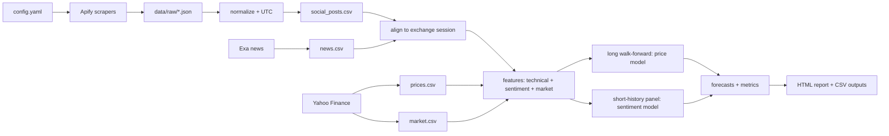

# Architecture

## Problem

Predict an asset's next-session close from public social chatter and news, with a validation design that does not leak the future. The pipeline covers five HKEX and five KRX names, two social sources per exchange, and Exa news.

## Data flow

## Stages

| Stage | Entry point | Output |
|---|---|---|
| Scrape | `sentpred scrape` | `data/raw/<source>_<exchange>.json`, `data/processed/social_posts.csv` |
| News | `sentpred news` | `data/processed/news.csv` |
| Prices | `sentpred prices` | `prices.csv`, `market.csv` |
| Model | `sentpred model` | `dataset.csv`, walk-forward predictions, metrics, forecasts |
| Report | `sentpred report` | `reports/index.html`, `summary.csv`, charts |

## Data contracts

Every social/news item is normalized to:

`source, exchange, ticker, text, published_utc, url, author, likes, reposts, views, followers`

`published_utc` is timezone-aware UTC. Price bars use the exchange-local calendar date. A post belongs to the session whose window is `(previous close, this close]`; posts after the close or on non-trading days roll to the next session.

## Modeling

**Long model.** One year of daily bars, expanding-window walk-forward, 60-session warm-up, 5-session test blocks, one-session purge gap. Compares naive, price-only Ridge, and price+sentiment Ridge. This measures whether the price/technical stack has an edge across the full year.

**Short-history sentiment panel.** A single 30-day Apify run yields only ~20 sentiment sessions, below the 60-session walk-forward warm-up, so the sentiment model uses a pooled panel: all tickers on each sentiment-covered session. The production model is a 6-component PLS on price technicals plus unweighted text sentiment levels and dynamics (`sent_chg`, `sent_ma3`, `sent_z`, `mention_chg`, `news_chg`, `news_social_div`). The control is the same PLS on price technicals only, so the ablation isolates the sentiment features. Predictions are shrunk 0.30 toward zero and clipped at ±5%. The primary short-panel check is chronological: each test session uses only older sessions, with the preceding session purged because its next-close label was unavailable; leave-one-session-out is a diagnostic. The headline forecast is fitted on completed price sessions only, so after-close pending rows stay in the report but out of model fitting. A small MLP, deep MLP, Random Forest, gradient boosting, nearest neighbours and Ridge+MLP blends were tested in `experiments/`; PLS was the most stable across both checks. Ridge remains as a linear reference for coefficients.

**No look-ahead.** The target for session `t` is `close(t+1)/close(t)-1`. Features for session `t` use only data known at the close of `t`. US market features, when enabled, use the previous US close. The long walk-forward purges the session immediately before each test block.

## Failure handling

- Each Apify run is capped with `maxTotalChargeUsd` and has a configurable timeout.
- A failed source logs an error and the pipeline continues with the remaining sources.
- Raw Apify datasets are cached, so `scrape --reuse-raw` can rebuild without paying twice.
- Missing price bars or empty source output are handled with explicit empty frames and warnings.

## Cost controls

`max_charge_usd` per source in `config.yaml`; `maxItems` and `pageSize` caps; a 30-day training window instead of unbounded history. The live run cost and Apify usage are documented in the README.

## Reproducibility

- All asset lists, keywords, windows, and model knobs live in `config.yaml`.
- Random Forest uses a fixed `random_state`.
- Raw API responses are cached under `data/raw/`.
- `reports/live/` contains a sanitized snapshot of the latest run.
- CI runs unit tests and the offline synthetic demo on every push.
